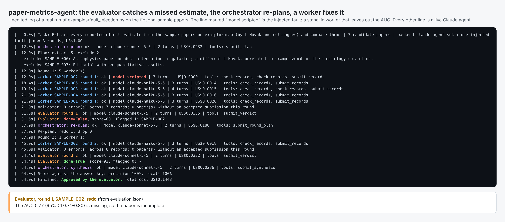
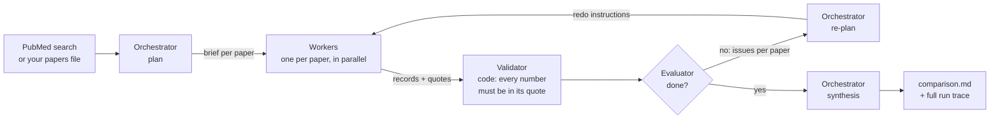

# paper-metrics-agent

[](https://github.com/Marknuttall101/paper-metrics-agent/actions/workflows/tests.yml)

A team of AI agents that reads research papers, extracts every statistical result (hazard ratios,
odds ratios, mean differences, AUC, sensitivity... with intervals, n and p-values), **checks each number
against the source text**, and compares the results across papers. An evaluator agent decides when
the job is done.

Built on the [Claude Agent SDK](https://pypi.org/project/claude-agent-sdk/):

- an **orchestrator** scopes the paper set and briefs the team;
- **workers**, one per paper running in parallel, extract the estimates;
- an **evaluator** reviews the work and sends papers back until it would sign the table off;
- **plain code** checks that every number appears, with its sign, in a quote taken word for word from the paper, and enforces round and budget limits.



## How it works



1. **Plan.** The orchestrator looks at the candidate papers and excludes what is out of scope.
   Examples are a paper by a different person with the same name, or an editorial with no results.
   It then writes a brief for each paper ("two outcomes; a 90% interval; n is written in words").
2. **Extract.** Each worker reads one abstract and records every estimate with a word-for-word quote.
   Its `check_records` tool flags any number that isn't in the quote, so the worker fixes mistakes
   before it submits.
3. **Validate.** Code re-checks every record: the quote must appear in the abstract, the value,
   interval and p-value must appear in the quote, and the interval must contain the value.
4. **Evaluate.** The evaluator compares each abstract with its records. It looks for missed estimates,
   wrong metric types, mislabelled outcomes and descriptive numbers recorded as results. It then marks
   each paper `ok` or `redo`, with exact fix instructions. It can only declare the job done when every
   paper is `ok` and the validator found no errors.
5. **Re-plan and redo.** The orchestrator turns the evaluator's issues into instructions, and only the
   flagged papers are redone. The loop repeats until the evaluator approves, the round limit is hit or
   the budget runs out.
6. **Synthesise.** The orchestrator gives every outcome a consistent name across papers and writes a
   summary that says what can and cannot be compared.

More detail, including every tool and stopping rule, is in [docs/architecture.md](docs/architecture.md).

## Results on the sample set

The sample set has seven fictional candidate papers. Five are about a made-up drug and two are decoys:
an astrophysics paper by a different "L Novak" and an editorial with no results. The five real papers
are written to include the hard cases: two outcomes in one abstract, a 90% interval, Lancet-style
decimals (`0·74`), thin-space thousands, n written in words, and descriptive numbers that must not be
extracted. A hand-checked answer key scores each run.

| Run (default models, November 2026) | Rounds | Decoys excluded | Precision / recall | n, CI and p fields correct | Cost |
|---|---|---|---|---|---|
| Live run (4 runs) | 1 | 2 of 2 (the decoys were in the last 3 runs) | 100% / 100% | 100% in the last 3 runs* | US$0.09-0.12 |
| Live run with one injected fault (2 runs; the screenshot above) | 2 | 2 of 2 | 100% / 100% | 100% | US$0.14-0.15 |
| Offline scripted demo (no AI) | 2 | 2 of 2 | 100% / 100% | 100% | US$0 |

\* In the first live run, the worker left n empty where the abstract gave one study-wide sample size, and it
kept "P=" prefixes on p-values. The prompts now cover n, and code normalises p-values. Every run since has
scored 100%. Each live run took about a minute. These numbers come from a small fictional set and show
that the loop works. They are not a benchmark: run `--gold` on your own hand-checked papers before relying on it.

## Quick start

You need Python 3.10+. Nothing else needs installing: the Claude Agent SDK package includes what it needs.

```bash
git clone https://github.com/Marknuttall101/paper-metrics-agent.git
cd paper-metrics-agent
python -m venv .venv
source .venv/bin/activate          # Windows: .venv\Scripts\activate
pip install -e .
```

**1. See the whole loop offline (free, no key):**

```bash
paper-metrics demo
```

This uses scripted agents that make one deliberate mistake, so you can watch the evaluator catch it
and the team fix it. No AI is called.

**2. Add your Anthropic API key** (create one at [console.anthropic.com](https://console.anthropic.com)):

```bash
export ANTHROPIC_API_KEY=sk-ant-...          # macOS / Linux
$env:ANTHROPIC_API_KEY = "sk-ant-..."        # Windows PowerShell
```

**3. Run the real agents on the sample papers** (about US$0.10), scored against the answer key:

```bash
paper-metrics demo --live
```

**4. Run them on an author's papers from PubMed:**

```bash
paper-metrics run --author "Smith JA" --max 8
paper-metrics run --author "Smith JA" --term "heart failure" --max 10 --max-budget-usd 1
```

Or on your own papers: a JSON list of `{pmid, title, year, journal, authors, abstract}`. Any unique id
works as the `pmid`.

```bash
paper-metrics run --papers my_papers.json --gold my_answer_key.json
```

Results go to `output/run-<timestamp>/`. Open `comparison.md` first.

## Options

| Option | Default | What it does |
|---|---|---|
| `--max-rounds` | 3 | Evaluator rounds before stopping without approval |
| `--max-budget-usd` | 2.00 (`demo`: 0.50) | Spending cap for the whole run (see Security and cost) |
| `--concurrency` | 4 | Workers running at once |
| `--orchestrator-model` / `--worker-model` / `--evaluator-model` | `sonnet` / `haiku` / `sonnet` | Model per role: an alias (`haiku`, `sonnet`, `opus`) or a full model ID |
| `--gold` | - | Answer key to score the run against (precision, recall, field accuracy) |
| `--out` | `output/run-<timestamp>` | Output folder |
| `--allow-other-auth` | off | Run without `ANTHROPIC_API_KEY`, e.g. through Bedrock or Vertex AI |
| `--quiet` | off | Print only the final summary |

The exit code is 0 when the evaluator approved the run and 3 when the run finished without approval.

## What a run writes

| File | Contents |
|---|---|
| `comparison.md` | Status, summary, and one table per metric and outcome group |
| `extractions.json` | The final records, each with its evidence quote (check the status line: approved or not) |
| `evaluation.json` | The evaluator's verdict on every paper, round by round |
| `run_report.json` | Plan, exclusions, cost by role, and every agent call with its tools, turns and cost |
| `run_log.md` | The timestamped log |

## Design choices

- **The agents judge; code checks.** Models are good at reading and judging, so they decide what is
  in scope, what counts as an estimate and whether the work is complete. Code is exact, so it checks
  that every number appears in its quote and that the quote appears in the paper. Neither is trusted to
  do the other's job.
- **Every output goes through a tool that can say no.** Each role finishes by calling a submit tool that
  validates its input. Mistakes come back to the agent while it is still working, as errors it can fix,
  instead of turning up later in a report.
- **The evaluator is gated.** It cannot approve a paper with validator errors, approve the run while any
  paper needs redoing, or ask for a redo without saying exactly what to fix.
- **A cheap model for narrow work, a stronger one for judgement.** By default workers run on `haiku` and
  the orchestrator and evaluator on `sonnet`. Change any of them with a flag.
- **Bounded by design.** Round limit, a budget reserved before every call and enforced by the SDK within each call, per-call turn limits and timeouts,
  one retry per agent call, and a fallback for every failure.
- **Nothing hidden.** `run_report.json` records every agent call, tool use and dollar spent.

## Security and cost

- The agents have **no built-in tools**: no shell, no file access, no web. They can only call this
  project's in-process tools, which read and write memory. Each run also ignores your Claude Code
  settings, CLAUDE.md files and MCP servers.
- Abstracts are treated as untrusted text and marked as such in every prompt. The agents can only submit
  records, decisions and verdicts through tools that check their input. A hostile abstract can still try to
  sway the agents' judgement (what to exclude, whether to approve), but it cannot reach your files or
  anything outside the run.
- Keep your API key in an environment variable. Never commit it (`.env` is git-ignored). `paper-metrics run`
  refuses to start without `ANTHROPIC_API_KEY`. Variables such as `CLAUDE_CODE_USE_BEDROCK`, `CLAUDE_CODE_USE_VERTEX`
  or `ANTHROPIC_BASE_URL` still redirect calls if they are set: the CLI warns about them, and `run_report.json`
  records which credential each call used.
- Set `--max-budget-usd` to whatever you are comfortable with. The default is US$2.00 per run (US$0.50 for `demo --live`). Before
  each agent call the pipeline reserves that call's share of what is left and passes it to the SDK as the
  call's own cap, so the run stays within the cap except for any overshoot on a call's final turn. The
  sample runs (five papers in scope) cost US$0.09-0.15. Cost grows with the number and length of
  abstracts and with each redo round.

## Claude Code mode (runs on your Claude subscription)

The repo also works as a Claude Code project. There, Claude Code itself is the agent, signed in with a
Claude Pro or Max plan, so no API key is needed. Open the folder in Claude Code and use:

```
/demo                                   # the sample papers, scored against the answer key
/compare-metrics "Smith JA" 8           # an author's 8 most recent PubMed papers
```

The extraction rules are in `CLAUDE.md`. The same validator, comparison and scoring tools run through
`python tools/<tool>.py`, and nothing needs installing. To check which account it's using, run
`/status`. If `ANTHROPIC_API_KEY` is set, Claude Code may use it instead of your subscription.
`scripts/run_headless.sh` and `scripts/run_headless.ps1` run it non-interactively with `claude -p`.

This mode is a single agent, with no separate orchestrator or evaluator. Use the pipeline above for those.

## Using the tools on their own

```bash
paper-metrics pubmed search --author "Smith JA" --max 8 --out output/papers.json
paper-metrics validate output/extractions.json --papers output/papers.json
paper-metrics compare  output/extractions.json --papers output/papers.json --out output/comparison.md
paper-metrics score    output/extractions.json --gold my_answer_key.json
```

None of these call a model. PubMed access is free. Optionally set `NCBI_API_KEY` to raise PubMed's
limit from 3 to 10 requests a second.

## Tests

```bash
pip install -e ".[dev]"
python -m pytest
```

The tests run offline, with no key and no network. They cover number parsing across typographic
styles, the validator, every role's tool rules, and the SDK wiring (agents get no built-in tools and no
local settings). They also run the full loop end to end: approval in round two, the round limit, the
budget cap, a missing submit being retried, and a dropped paper. CI runs them on Linux, macOS and
Windows for Python 3.10 and 3.13.

`examples/fault_injection.py` is a live check of the redo loop (needs a key, about US$0.15). It swaps
one worker for a faulty one and passes only if the real evaluator catches the fault and the team fixes it.

## Project layout

```
src/paper_metrics/
  agents/          orchestrator, worker and evaluator roles, pipeline, SDK and scripted backends, prompts
  pubmed.py        PubMed search and fetch
  validate.py      the number and quote checks
  compare.py       the Markdown report
  score.py         precision and recall against an answer key
  schema.py        the record format
  sample_data/     fictional papers and the answer key
tools/             thin wrappers used by Claude Code mode
.claude/           Claude Code mode commands and permissions
docs/              architecture notes and the screenshot
examples/          fault-injection check and the offline demo report
tests/
```

## Limits

- It reads abstracts. Results reported only in full-text tables are missed unless you supply the
  full text as the `abstract` field.
- PubMed author search matches name strings. The orchestrator excludes obvious namesakes, but give
  initials or a `--term` for common names.
- The validator proves each number is in the source text. The evaluator checks it is paired with the
  right outcome. Both can still miss things, so read `comparison.md` before relying on it, and score
  with `--gold` on a hand-checked set for anything important.

## Licence

MIT
