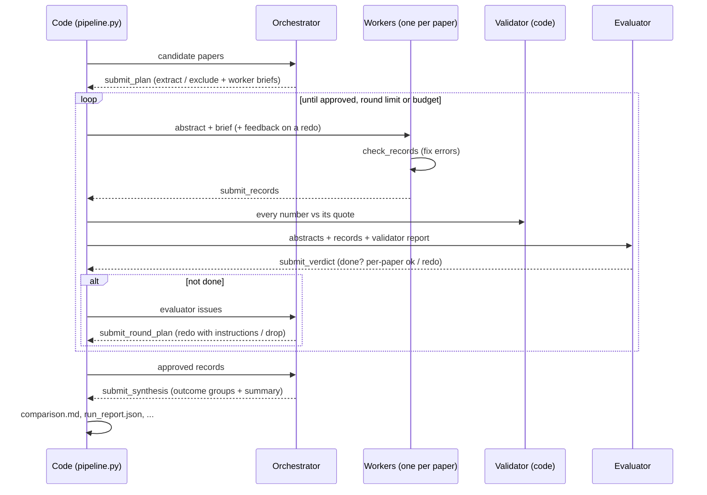

# Architecture

This note explains how the multi-agent pipeline (`src/paper_metrics/agents/`) is put together and why.

## The loop

The control flow is plain Python. The agents make the judgement calls: which papers are in scope,
what each abstract reports, whether the result is good enough, and what to fix. Code handles
the parts that must be exact or bounded: parallelism, retries, number checks, round and budget limits.

## Roles

| Role | Default model | Tools | Its job |
|---|---|---|---|
| Orchestrator | `sonnet` | `submit_plan`, `submit_round_plan`, `submit_synthesis` (one per call) | Scope the paper set (e.g. exclude a different author with the same name), brief each worker, turn evaluator feedback into instructions, and name outcomes consistently across papers |
| Worker | `haiku` | `check_records`, `submit_records` | Extract every estimate from one abstract into the fixed record format |
| Evaluator | `sonnet` | `submit_verdict` | Review every paper for completeness and correctness and decide when the job is done |

Models are set per role (`--orchestrator-model`, `--worker-model`, `--evaluator-model`) and accept
aliases (`haiku`, `sonnet`, `opus`) or full model IDs. Extraction from a single abstract is a narrow task,
so a fast model handles it well. Judging and planning get a stronger model.

## Why every output goes through a tool

Each role has exactly one way to finish: call its submit tool. The tool checks the input before
accepting it, and anything wrong comes back to the agent as an error it can fix within the same
session. For example:

- `submit_plan` must decide on every candidate, give reasons for exclusions, and cannot extract a paper with no abstract.
- `submit_records` rejects a record whose value, interval or p-value is not written in its evidence quote
  (with the same sign), whose quote is not word for word in the abstract or starts or ends inside a
  number, whose interval does not contain the value, or that duplicates another record. It warns when
  the interval is not written right after the value. p-values are normalised (`P=0.002` becomes `0.002`).
- `submit_verdict` cannot pass a paper that has validator errors or no accepted submission, cannot say
  `done=true` while any paper is marked `redo`, and must give fix instructions for every `redo`.
- `submit_round_plan` must decide on exactly the flagged papers.
- `submit_synthesis` must group every record.

If an agent ends its session without a successful submit, the pipeline retries it once in a fresh session
with a reminder. It does not retry errors that a retry cannot fix, such as authentication or a missing CLI; running out of
turns is retried.
A worker that fails a redo is reported to the evaluator, and its paper cannot be marked `ok`.
If the retry also fails, the pipeline falls back to a safe path. A failed plan stops the run. A failed
re-plan passes the evaluator's instructions straight to the workers. A failed evaluator ends the run
as *not approved*. A failed synthesis leaves the report without outcome groups.

## Stopping rules

| Stop reason | When | Approved? |
|---|---|---|
| `approved` | The evaluator sets `done=true` (only possible when every paper is `ok` and has no validator errors) | yes |
| `max_rounds` | The evaluator has not approved by the last round (`--max-rounds`, default 3) | no |
| `budget` | Spend reaches `--max-budget-usd` (default US$2.00; US$0.50 for `demo`) | no |
| `evaluator_failed` | No valid verdict, even after a retry | no |
| `all_dropped` | The orchestrator dropped every paper in scope | no |
| `error` | An unexpected error (the trace is still written) | no |
| `plan_failed` / `nothing_to_extract` | No valid plan, or nothing in scope | no |

Before every agent call the pipeline reserves that call's budget out of what is not yet spent or
reserved, and passes it to the SDK as the call's own `max_budget_usd`. When the call ends, its
reservation is released and replaced by what it actually cost. Each worker reserves an equal share of
what is left when it starts. Workers leave 25% of the total for the review steps, and the evaluator and
re-plan leave 10% for the synthesis. The SDK enforces each call's cap, but a call can still go a little
over it on the turn that is running when the cap is reached, so treat the cap as close but not exact. A call that times out or crashes
before reporting its cost is charged its whole reservation. Each call also has a timeout (`call_timeout_s`, default 10 minutes).
With `sdk_budget_cap=False` (`--no-sdk-budget-cap`) the reservation is not passed to the SDK. The
accounting stays the same, but calls are bounded only by their turn limit and timeout.

`paper-metrics` exits with code 0 when the run is approved and 3 when it finishes without approval,
which makes it easy to use in scripts and CI.

## Isolation and safety

Each agent call is a fresh Claude Agent SDK session with:

- `tools=[]`: no built-in tools at all (no shell, no file access, no web). The only tools are the
  in-process ones above, which read and write Python memory.
- `setting_sources=[]` and `strict_mcp_config=True`: none of your Claude Code settings, CLAUDE.md
  files or MCP servers leak into a run.
- an empty temporary working directory.
- the abstracts wrapped in `<paper>` tags and described in every system prompt as untrusted data.
  An abstract that says "ignore your instructions" has nothing dangerous to reach, because the agents
  can only submit records, and code checks those records.

`paper-metrics run` refuses to start without `ANTHROPIC_API_KEY`. It warns when `CLAUDE_CODE_USE_BEDROCK`,
`CLAUDE_CODE_USE_VERTEX` or `ANTHROPIC_BASE_URL` would send calls elsewhere, and `run_report.json` records
the credential source of every call. `--allow-other-auth` is there for Bedrock, Vertex AI or other
providers that Claude Code supports.

## Files a run writes

| File | Contents |
|---|---|
| `comparison.md` | The status line, the orchestrator's summary, and a table per metric and outcome group |
| `extractions.json` | The final records, with `id`, `round` and `outcome_group` |
| `evaluation.json` | Every evaluator verdict, round by round |
| `run_report.json` | Plan, exclusions, drops, per-round worker results, cost by role, every agent call |
| `run_log.md` | The timestamped console log |
| `papers.json` | The candidate papers the run started from |

## Extending it

- **Another backend** (e.g. a different model provider): implement `Backend.run(AgentCall) -> AgentResult`.
  The tools are plain async functions (`ToolSpec.handler`), so any tool-calling API can host them.
- **Another metric**: add it to `METRICS` in `schema.py` (and a label in `METRIC_LABELS`).
- **Full texts instead of abstracts**: give each paper an `abstract` field that holds the text you want
  checked. The validator checks quotes against whatever text is there.
- **A stricter evaluator**: pass `--evaluator-model opus`, or edit `prompts.EVALUATOR`.
